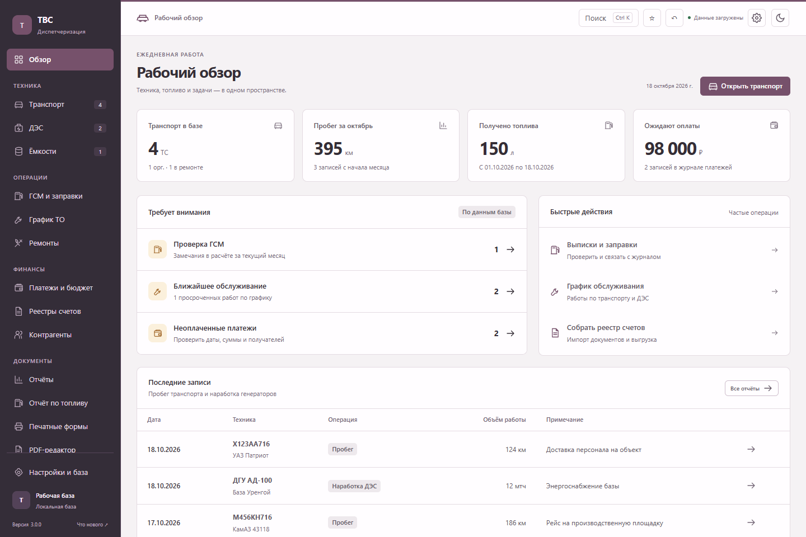

# Диспетчеризация авто ТВС — прототип 3.0

**Эта ветка содержит прототип 3.0 для изучения и ручного тестирования. Он не опубликован как релиз и не распространяется через автообновление.** Стабильная версия находится в `main`; её `version.json` этим прототипом не изменяется.

Windows-приложение для учёта транспорта, дизельных генераторов, ГСМ, ТО, ремонтов и платежей ООО «Технрайз Велл Сервис». Версия исходников прототипа — **3.0.0**. Выбрана палитра «Камень и слива» для светлой и тёмной темы.



[Описание прототипа и проверки](docs/PROTOTYPE_3.0.md) · [Тёмная тема](docs/prototype-3.0/dark.png) · [Транспорт](docs/prototype-3.0/transport.png)

В прототипе доступны очереди замечаний с переходом к конкретной записи, ввод смены по нескольким ТС, предпросмотр и отмена импорта, поиск `Ctrl+K` и сохранённые выборки, заявки ТО/ремонта, связанные счета с частичной оплатой и история изменений с проверяемым восстановлением. Подробные сценарии — [в руководстве](docs/WORKFLOWS_3.0.md).

## Запуск и сборка

Требуются Windows 10/11 x64 и Node.js 22.13+ (либо Node.js 24+). В установленном приложении отдельный Node.js не нужен.

```powershell
npm ci
npm start
npm test
npm run test:ui
npm run test:electron
npm run build
```

Браузерные и Electron-тесты используют Playwright. Его можно установить в отдельную папку и задать `TVS_PLAYWRIGHT_MODULES` — путь к её `node_modules`. Для браузерных тестов нужен Chromium (`playwright install chromium`) или установленный Edge. Пример настройки есть в `.github/workflows/verify.yml`. Electron-тест создаёт отдельные временные базы и профиль; рабочая база пользователя не используется.

Локальный установщик появляется в `dist/Dispatcher-Setup-3.0.0.exe`. Push этой ветки запускает только проверки: выпуск и изменение `version.json` не выполняются. Процессы выпуска дополнительно отклоняют теги на коммитах, не вошедших в `main`.

Стабильный выпуск в будущем требует отдельной подготовки и решения о публикации: изменения должны войти в `main`, затем процесс по соответствующему тегу проверяет программу, собирает установщик и публикует контрольную сумму. Только стабильный процесс выпуска обновляет `main/version.json`.

## Данные и резервные копии

По умолчанию база находится в `Documents/ДиспетчеризацияАвто_ТВС`; путь выбирается в настройках. Каждый профиль может использовать свою папку.

- `sections/*.json` — рабочие разделы базы; `revisions.json` хранит версии для синхронизации.
- `.transaction.json` — журнал восстановления незавершённой записи. Не удаляйте его вручную.
- `backups/data_YYYY-MM-DD.json` — ежедневные снимки, сохраняются последние 30 копий.
- `backups/manual_*.json` — ручные снимки из настроек, автоматически не удаляются.
- `history/change_*.json` — история операций с состоянием записей до и после; она сохраняется вместе с изменениями базы. Для переноса истории копируйте всю папку базы, включая `history`.
- Старый `data.json` сохраняется после миграции как исходная копия; при наличии `sections` он уже не является рабочей базой.

Перед переносом базы закройте приложение на сервере и скопируйте всю папку данных. После переноса выберите её в настройках. JSON-импорт дополняет данные; он не является полной заменой базы из снимка.

Если основная база недоступна, приложение открывает отдельный резервный снимок этой базы для просмотра и блокирует запись. Постоянное сообщение показывает этот режим. В настройках доступны проверка структуры, отсутствующих связей, повторяющихся идентификаторов и создание копии вручную. Проверка не исправляет и не пересчитывает данные автоматически.

## Работа нескольких пользователей

На одном компьютере выберите «Сервер», на остальных — «Клиент». Укажите адрес, порт (по умолчанию `3377`) и одинаковый ключ сети длиной от 16 знаков. Доступ предназначен для доверенной локальной сети; транспорт HTTP не шифруется. Для доступа извне используйте защищённую сеть/VPN, не открывайте порт в интернет.

Изменения сохраняются по разделам с проверкой версии. Независимые поля объединяются. Если два пользователя изменили одно поле, либо один удалил изменённую другим запись, сохранение остановится с сообщением о конфликте. Сверьте введённые значения, затем заново откройте запись после обновления данных. Старые клиенты следует обновить вместе с сервером.

## Структура

Интерфейс 3.0 использует постоянную навигацию по разделам и рабочий обзор с показателями текущей базы. Транспорт и ДЭС доступны таблицами и карточками. Светлая/тёмная тема сохраняется в настройках приложения и синхронизируется с открытыми окнами документов. Клавиша `/` переводит фокус в поиск техники.

| Путь | Назначение |
| --- | --- |
| `index.html`, `assets/css` | Основной интерфейс |
| `assets/js/01-core.js` | Загрузка, сохранение и индексы |
| `assets/js/25m-workspace.js`, `assets/css/workspace.css` | Постоянная навигация, рабочий обзор и глобальный дизайн |
| `assets/css/document-workspace.css` | Оформление отдельных окон документов |
| `assets/js/25f-sync.js` | Синхронизация и слияние записей |
| `assets/js/25i-gsm-ledger.js` | Расчёт движения и остатков ГСМ |
| `assets/js/25l-manual-fuel.js` | Ручные выписки и связь с журналом |
| `electron/main.js`, `preload.js` | Нативные окна, файлы и IPC |
| `electron/storage.js`, `server.js` | Хранилище и сетевой API |
| `electron/security.js`, `updater.js` | Проверка источников запросов и обновлений |
| `ReestrBuilder/lib.mjs` | PDF/OCR и формирование реестров Excel |
| `pdf-editor.html`, `reestr-window.html` | Отдельные окна документов |
| `tests` | Проверки расчётов, хранения, сети, интерфейса и Electron |

Файлы `assets/js` загружаются по порядку, `26-boot.js` — последним. Бизнес-логика пока использует общее состояние без UI-фреймворка. Изменения расчётов следует проверять одновременно в журнале, сверке и выгрузке актов.

`des-app` и самостоятельный `ReestrBuilder` имеют собственные номера версий и отдельные процессы выпуска. Ветка прототипа не запускает ни один из них.

История изменений: [CHANGELOG](assets/CHANGELOG.md). Источники и решения по обновлению: [обзор 3.0](docs/RELEASE_3.0.md).
