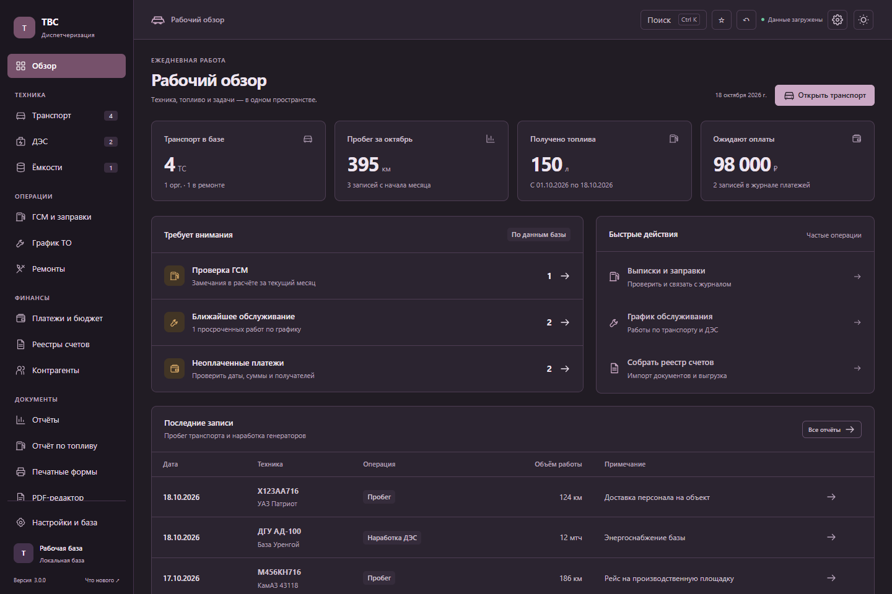
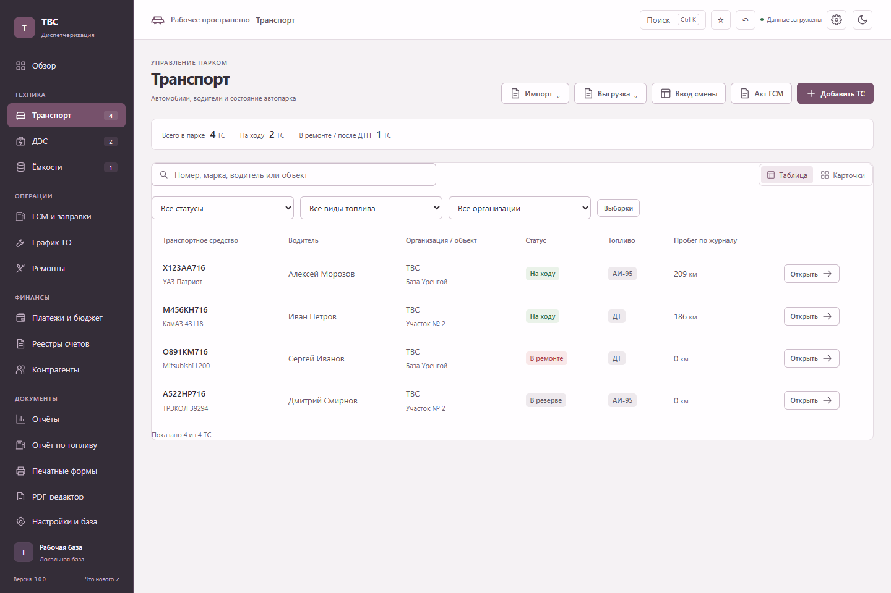

# Прототип 3.0 — «Камень и слива»

Статус на 18 октября 2026 года: прототип для просмотра кода и ручного тестирования. Ветка `codex/prototype-3.0-stone-plum` отделена от стабильной `main`.

## Распространение

- Автообновление установленных приложений читает только `main/version.json`. Публикация этой ветки не изменяет этот файл.
- Для прототипа не создаются теги, GitHub Release и запись в канале обновлений.
- Push ветки запускает только Verify с правами чтения. Все три процесса выпуска проверяют, что помеченный тегом коммит уже входит в `main`, и останавливаются до сборки и публикации, если это не так.
- Исходники можно собрать вручную по инструкции в README. Каталог `dist` и локальный установщик в Git не включены.

## Что включено

- Постоянная навигация, рабочий обзор на данных базы, таблицы и карточки транспорта и ДЭС.
- Палитра «Камень и слива», согласованные светлая и тёмная темы, формы, настройки, реестры и PDF-редактор.
- Защита сохранения, синхронизации, импортов и отдельных окон, диагностика базы и ручное резервное копирование. Подробности — в [техническом обзоре](RELEASE_3.0.md).

## Проверки локальной сборки

117 проверок логики, хранения, сети и безопасности; 81 сценарий интерфейса; интеграционная проверка собранного Electron. Экраны и формы проверены при 1280×900 и 960×700 в обеих темах. Контраст текста основных кнопок: 6,65:1 в светлой теме и 7,98:1 в тёмной.

Дополнительно реализованы [семь рабочих сценариев](WORKFLOWS_3.0.md): очереди замечаний, ввод смены, предпросмотр/отмена импорта, общий поиск и выборки, заявки, связанные оплаты и восстановление истории. Регрессии проверяют более поздние изменения, прерывание записи на диск, закрытые месяцы и переключение сервера между копиями баз.

Все иллюстрации ниже используют искусственные тестовые данные.

### Светлая тема

### Тёмная тема

### Транспорт

