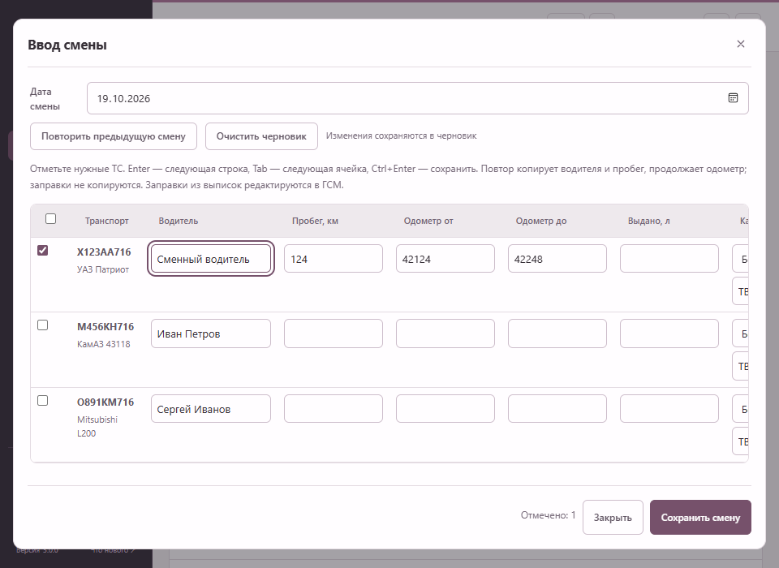
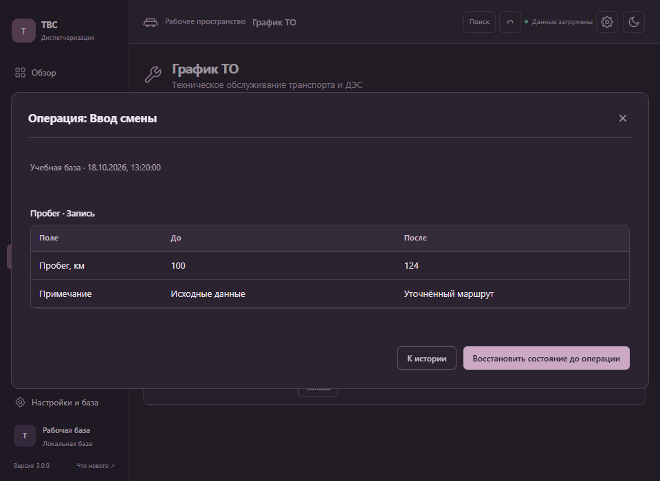

# Рабочие сценарии прототипа 3.0

Этот пакет находится в ветке прототипа и не публикуется в автообновления.

## 1. Проверить замечания из обзора

Нажмите «Проверка ГСМ», «Ближайшее обслуживание» или «Неоплаченные платежи». Список показывает конкретные операции. Открытие строки переводит к нужной заправке, записи пробега, заявке или счёту. Панель снизу сохраняет контекст проверки: после сохранения формы нажмите «Следующее», чтобы перейти к следующей записи, или «К списку», чтобы пересчитать оставшиеся замечания. Для ГСМ можно изменить месяц. «Завершить проверку» закрывает очередь.

Последние записи на главном экране открывают именно выбранную запись журнала.

## 2. Внести смену

В «Транспорт» нажмите «Ввод смены». Выберите дату и отметьте нужные машины. Заполните водителя, пробег, одометры и при необходимости выдачу топлива с картой/организацией. «Повторить предыдущую смену» переносит водителя и пробег и продолжает одометр; повторная заправка автоматически не создаётся.

Все отмеченные строки проверяются до записи и сохраняются одной операцией. Ошибка одной строки блокирует весь пакет. Для нескольких записей одной машины за день используйте обычный журнал. Топливо, уже связанное с выпиской, изменяется в ГСМ. Закрытый месяц и устаревший исходный журнал блокируют сохранение.

Черновик привязан к выбранной базе и дате. После закрытия окна его можно открыть повторно. `Tab` переводит между ячейками, `Enter` — на следующую строку, `Ctrl+Enter` сохраняет смену.

## 3. Импортировать с предварительной проверкой

Для Excel выберите строку заголовков и сопоставьте столбцы. Настройку можно сохранить под именем поставщика; при перестановке столбцов шаблон сопоставляет их по заголовкам. Поддерживаются отдельные шаблоны разных видов импорта.

Следующий экран показывает добавления, изменения и удаления со значениями до/после. База сохраняется только после «Применить импорт». Отмена до применения не изменяет базу. Для PDF, RAR и JSON перед общим предпросмотром сохраняется прежний выбор исходных данных; поездки ГЛОНАСС и алиасы объектов также проходят предпросмотр.

В ГСМ → «История загрузок» доступна история пакетов. Отмена пакета восстанавливает только его строки. Более поздние изменения этих строк, новые/изменённые связи и закрытый месяц блокируют отмену. Для больших файлов изменения показаны страницами.

## 4. Найти запись и сохранить выборку

`Ctrl+K` или «Поиск» в верхней панели открывает поиск по технике, водителям, счетам, контрагентам и сохранённым выборкам. Стрелки выбирают результат, `Enter` открывает запись. Сохранённый реестр сначала открывается для просмотра; переход к редактированию выполняется отдельной командой.

Настройте фильтры списка и нажмите ☆ в верхней панели или «Выборки» в транспорте. Сохраняются поиск, фильтры, период и вид представления. Выборки и черновики относятся к текущей базе. Перед переходом из незавершённой формы сохраните или закройте её.

## 5. Вести ТО и ремонт как заявку

В карточке работы доступны исполнитель, сервис/подрядчик, работы, материалы, ожидаемая готовность, начало и конец простоя. Состояния: «Назначено», «В работе», «Выполнено». При завершении фиксируется фактическая дата; для автоматического плана сохраняется исходный плановый срок и обновляется следующий интервал. Перестроение плана не удаляет уже начатые работы и заявки со счетами.

## 6. Связать заявку, счёт и оплаты

В сохранённой заявке нажмите «Создать счёт по заявке». Счёт сохраняет связь с исходной работой. В счёте доступны срок оплаты, оплаченная сумма и отдельные платежи с датой/основанием. Полностью оплаченный счёт закрывает задолженность связанной заявки при согласованной сумме.

Расхождение стоимости заявки и суммы счёта, потерянная ссылка и несколько счетов по одной заявке показываются явно. Сумма не заменяется автоматически. Оплаченные документы и заявки со связанными счетами защищены от удаления. Обзор, финансовая таблица, отчёт и Excel показывают фактически оплаченные суммы и остаток долга.

## 7. Посмотреть и восстановить операцию

Кнопка ↶ в верхней панели открывает историю. Для каждой операции показаны профиль, время, разделы и изменённые значения. Указанное имя — профиль программы; это не отдельная система подтверждённых учётных записей.

«Восстановить состояние до операции» проверяет текущее состояние всех затронутых строк и связанные документы. Несовпадение с сохранённым состоянием после операции останавливает восстановление. Изменения других строк сохраняются. Закрытые месяцы и исходные данные расчёта ГСМ защищены; восстановление также создаёт новую запись истории.

Проверка базы привязывает сетевые операции к фактически обслуживаемой базе, а не только адресу сервера. При переключении базы откройте предпросмотр или историю заново.

История хранится в `history` внутри папки базы и записывается в одной транзакции с разделами. Восстановление незавершённой транзакции либо завершает данные и историю вместе, либо откатывает их вместе. Для переноса с историей копируйте всю папку базы.

